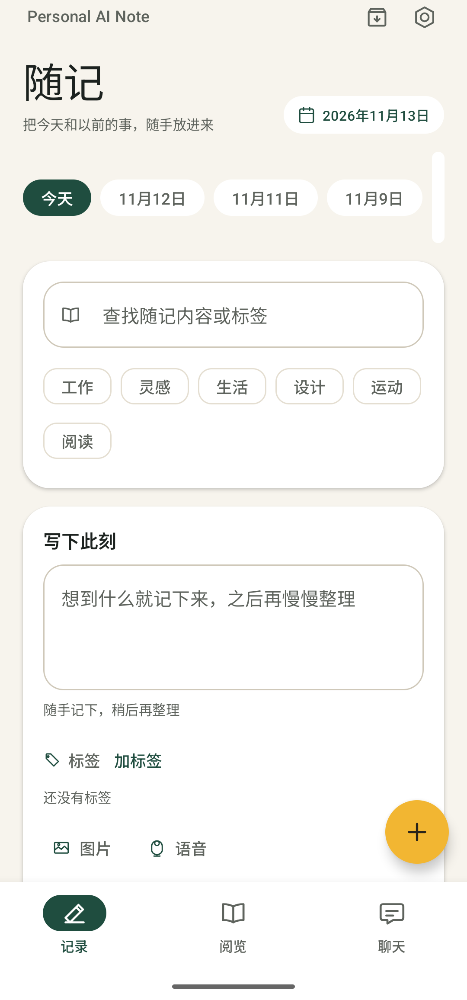
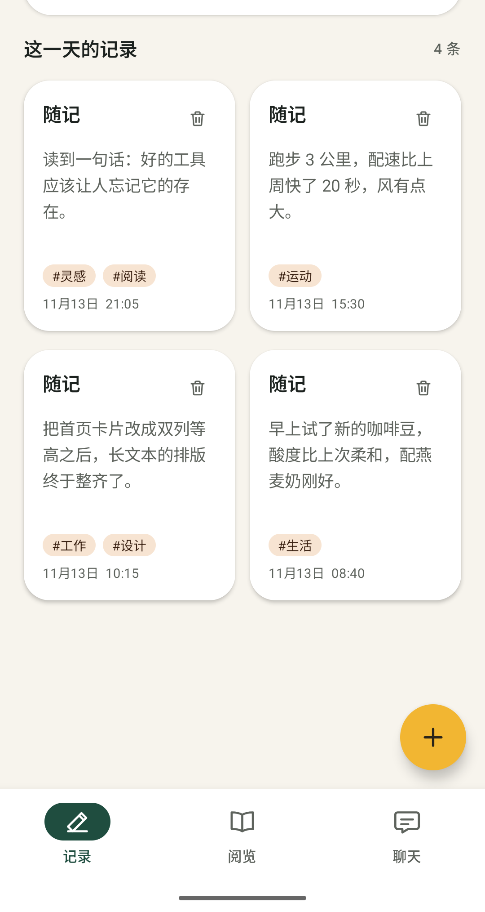
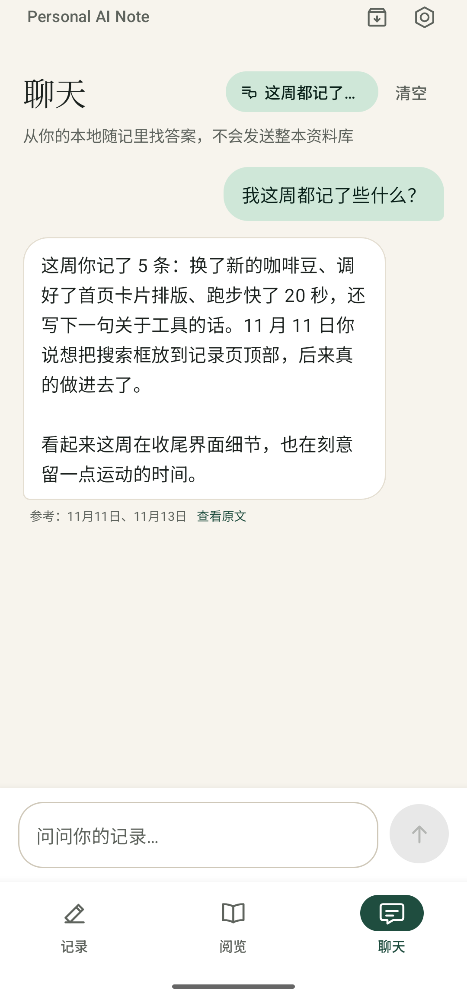
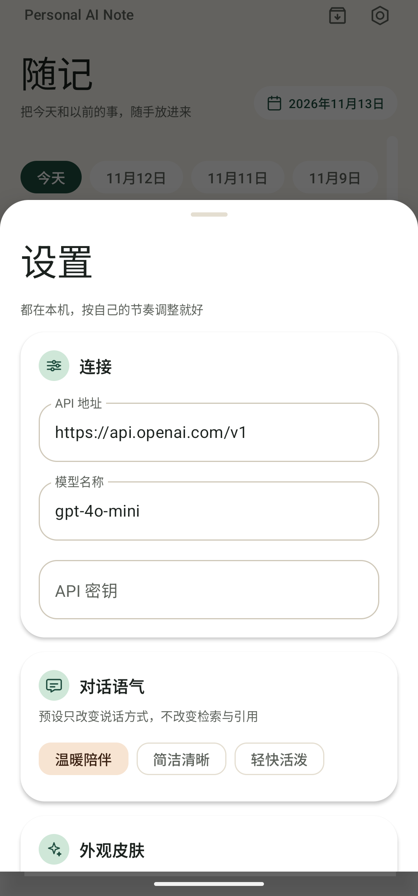
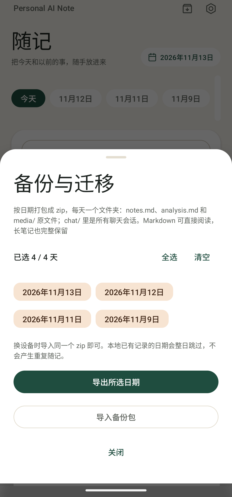

<div align="center">

# Personal AI Note

**随手记下，交给 AI 整理，再随时问它。**

一个本地优先的 Android 随记应用：文字、图片、语音随手记，每天整理成 Markdown，再基于自己的历史记录聊天。不上传、无账号、无埋点。


[功能](#功能) · [截图](#截图) · [快速开始](#快速开始) · [从源码构建](#从源码构建) · [文档](#文档) · [路线图](#路线图)

</div>

---

## 功能

- **随手记**：一个输入框写所有内容，支持文字、图片、录音，可补录过去的日期；写的时候就能选标签。
- **找得到**：跨日期全局搜索正文与标签，标签自动聚合成筛选 chip，点开就是整页只读阅览。
- **每日整理**：调用任意 OpenAI-compatible 接口，把当天内容整理成结构化 Markdown（任务 / 建议 / 回顾可开关），原文与整理结果都留在本地。
- **本地上下文聊天**：支持多会话。回答参考最近的记录（默认近 7 天、关键词检索、约 2000 字符预算），气泡下方「查看原文」能逐条回溯真正被引用的随记。
- **图片与语音**：图片压缩后交给视觉模型生成描述，录音交给转写模型，结果一并进入检索。
- **备份与迁移**：按日期导出 zip，每天一个文件夹（`notes.md` / `analysis.md` / `media/`），另有 `chat/conversations.md` 保存全部会话。Markdown 人可读，导入时按日期合并，旧 JSON 备份仍可导入。
- **外观与人格**：4 套配色、3 种聊天语气，只影响呈现，不改数据与检索逻辑。

## 截图

<div align="center">

| 随记 | 随记卡片 | 聊天 |
|:---:|:---:|:---:|
|  |  |  |
| 搜索、标签筛选与输入框 | 双列等高卡片，标签与时间完整 | 回答带引用，可点回原文 |

| 设置 | 备份与迁移 |
|:---:|:---:|
|  |  |
| 接口、语气、皮肤都在本机 | 按日期打包，换设备导入同一个 zip |

</div>

## 快速开始

1. 安装 APK（从 [Releases](../../releases) 下载，或按下方步骤自行构建）。
2. 首次启动后打开右上角「设置」，填写你的 AI 服务：
   - **API 地址**：OpenAI-compatible 服务根地址，例如 `https://api.openai.com/v1`
   - **模型名称**：聊天与整理使用的模型
   - **API 密钥**：只保存在本机，经 Android Keystore 加密
3. 回到「记录」页写下第一条随记。

> 不配置 AI 也能用：随记、搜索、标签、阅览、备份全部是本地功能，只有整理、聊天、图片理解、语音转写需要接口。

## 数据与隐私

- 随记、整理结果、聊天记录、媒体文件都存在**本机 App 私有目录**（Room + 文件），没有云端同步。
- 唯一联网的地方是你自己配置的 AI 接口，且只发送当前这次请求需要的内容。
- **源码与安装包里不含任何 API 地址、模型名或密钥**；密钥由用户在自己的设备上填写，经 Keystore 加密后保存，不会写进版本库。
- 仓库只提交源码：`keystore.properties`、`local.properties`、`*.jks` 与 `app/build/` 均在 `.gitignore` 中。

## 从源码构建

需要 Android Studio、Android SDK Platform 37、JDK 17+。依赖版本见 [`gradle/libs.versions.toml`](gradle/libs.versions.toml)（AGP 9.5.0 / Kotlin 2.2.10 / Compose BOM 2026.02.01 / Room 2.8.4），`minSdk 24`。

```bash
git clone git@github.com:tyxiumud/presonal_ai_note.git
cd presonal_ai_note
./gradlew assembleDebug
```

没有 `keystore.properties` 时，release 包会退回 debug 签名并打印警告（仅可本机调试，不要分发）。要打正式包，复制 [`keystore.properties.example`](keystore.properties.example) 为 `keystore.properties` 并填入 4 个值，详见 [打包与签名](docs/release-signing.md)。

## 项目结构

```text
app/src/main/java/io/github/tyxiumud/personalainote/
├── journal/      随记：Room 实体、仓库、记录页与整页阅览
├── analysis/     每日整理：Markdown 生成、来源指纹、阅览页
├── chat/         多会话聊天：上下文构建、引用、会话表
├── media/        图片理解与语音转写
├── backup/       zip 导入导出（含聊天与媒体）
├── ai/           OpenAI-compatible 网络层与设置
├── ui/           主题、导航、通用组件
└── AppContainer.kt  手写依赖注入
```

架构说明见 [架构框图](docs/architecture.html)，三篇教程从数据流讲到上下文构建。

## 文档

| 文档 | 内容 |
|---|---|
| [开发进度与待办](docs/DEV_ROADMAP.md) | 当前做到哪、接下来做什么 |
| [架构框图](docs/architecture.html) | 四层架构，浏览器直接打开 |
| [设计文档](docs/superpowers/specs/2026-11-04-personal-ai-vault-design.md) | 产品边界、数据设计、里程碑与验收标准 |
| [教程 1：本地文字随记](docs/tutorial/01-local-text-journal.md) | Room / ViewModel / Composable 数据流 |
| [教程 2：AI 每日整理与阅览](docs/tutorial/02-ai-daily-markdown-and-reader.md) | 密钥存放、网络层、来源指纹 |
| [教程 3：本地上下文聊天](docs/tutorial/03-local-context-chat.md) | 上下文构建、引用可追溯 |
| [打包与签名](docs/release-signing.md) | release 包、keystore、R8 规则、上架前清单 |

## 路线图

- [x] 本地随记、标签、全局搜索
- [x] 每日 AI 整理与 Markdown 阅览
- [x] 本地上下文聊天、多会话、引用可追溯
- [x] 图片理解、语音转写
- [x] 含聊天与媒体的 zip 备份
- [ ] 定时整理与通知（WorkManager）
- [ ] 会话重命名与会话内搜索
- [ ] 导入时选择「覆盖 / 合并」

完整清单见 [DEV_ROADMAP.md](docs/DEV_ROADMAP.md)。

## 参与贡献

欢迎 issue 和 PR。提交前请确认没有把 `keystore.properties`、`local.properties` 或 `*.jks` 带进版本库。

```bash
./gradlew testDebugUnitTest          # 单元测试
./gradlew connectedDebugAndroidTest  # 设备测试（需连接设备或模拟器）
```

## 许可证

[MIT](LICENSE) © 2026 tyxiumud
